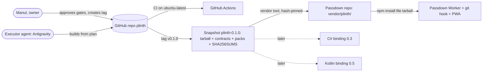
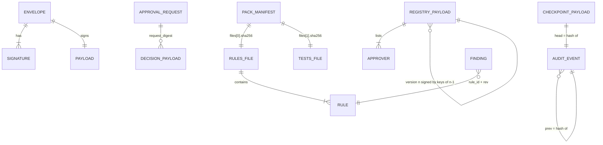
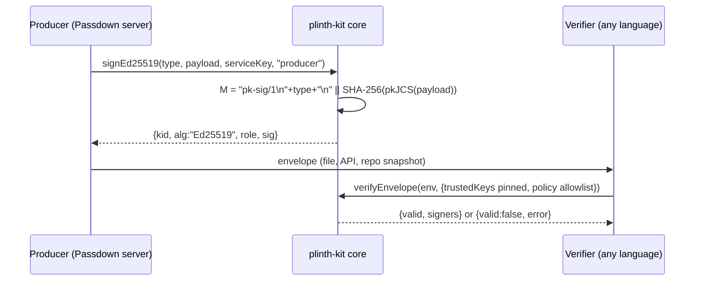
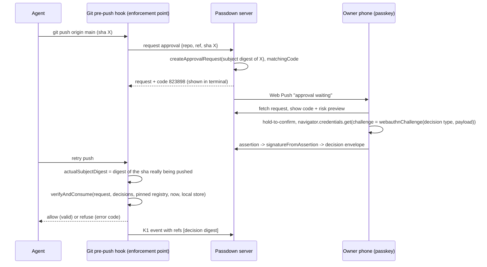
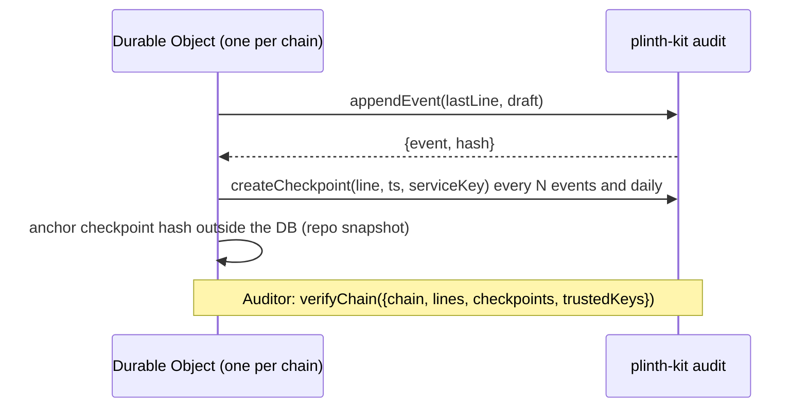

# Plinth 0.1: architecture

**Status:** Stage 3, v1.0 (2026-10-31). Contracts: `contracts/`. Decisions: `docs/decisions/`.

## 1. Context and components



```mermaid
flowchart TB
  subgraph pkg[npm package plinth-kit: packages/ts]
    core[core: bytes, json, jcs, keys, der, envelope, webauthn, ids]
    audit[audit: event, jsonl, checkpoint, verify, lint]
    approval[approval: request, registry, verify, store, breakglass]
    rulepack[rulepack: load, asof]
    detect[detect: validators, entropy, scan, redact]
    packs[packs: builtin.ts generated]
    tools[tools: conformance CLI, Node only]
  end
  subgraph repo[repo-only, not shipped]
    rt[repo-tools: yaml-subset, regex-lint, schema, compile-packs, detect-file, snapshot, vendor]
  end
  audit --> core
  approval --> core
  detect --> rulepack --> core
  audit -->|lintPersonalData| detect
  tools --> core & audit & approval & rulepack & detect & packs
  rt --> core & rulepack & detect
  rt -->|writes| packs
  noble[(@noble/curves, @noble/hashes, @scure/base)] --> core
```
Plinth is a **library plus data**. It has no server, database, UI, background job or network call.

## 2. Stack (checked 2026-10-31 with `npm view <pkg> version license time`; rule: exact pin, published ≥ 14 days before pinning, ADR-0008)
| Component | Package / tool | Exact version | Licence | Why | Published | Source |
|---|---|---|---|---|---|---|
| Runtime for tools/tests | Node.js | 24.16.0 (LTS line 24) | MIT | Installed on the owner's PC; ESM, `crypto.getRandomValues`, `String.isWellFormed` | — | https://nodejs.org/en/download |
| Package manager | npm | 11.13.0 (bundled with Node 24.16.0) | Artistic-2.0 | No extra install; workspaces; lockfile (ADR-0003) | — | https://docs.npmjs.com/ |
| Curves | `@noble/curves` | 2.4.0 | MIT | Audited, pure JS, same in Node/browser/Workers; Ed25519 + P-256 (ADR-0005) | 2026-08-27 | https://www.npmjs.com/package/@noble/curves |
| Hashes | `@noble/hashes` | 2.4.0 | MIT | SHA-256, HMAC (ADR-0005) | 2026-08-27 | https://www.npmjs.com/package/@noble/hashes |
| Encodings | `@scure/base` | 2.4.0 | MIT | Strict base64url-no-pad and base32 (ADR-0005) | 2026-08-28 | https://www.npmjs.com/package/@scure/base |
| Compiler | `typescript` | 7.0.2 | Apache-2.0 | Type-check and emit JS + `.d.ts` (ADR-0009) | 2026-07-08 | https://www.npmjs.com/package/typescript |
| Tests | `vitest` | 5.0.5 | MIT | Fast ESM tests (ADR-0009) | 2026-10-15 | https://www.npmjs.com/package/vitest |
| Vitest peer | `vite` | 8.3.4 | MIT | Required peer of vitest 5 | 2026-10-08 | https://www.npmjs.com/package/vite |
| Lint + format | `@biomejs/biome` | 2.5.15 | MIT OR Apache-2.0 | One dependency for lint and format (ADR-0009) | 2026-09-30 | https://www.npmjs.com/package/@biomejs/biome |
| Node types | `@types/node` | 24.19.2 | MIT | Types for tools and tests only | 2026-10-09 | https://www.npmjs.com/package/@types/node |
| JSON Schema | `ajv` | 8.20.0 | MIT | Validates contracts in tests and the compiler; **never at runtime** (Workers forbid `new Function`) | 2026-04-24 | https://www.npmjs.com/package/ajv |
| YAML | `yaml` | 2.9.1 | ISC | YAML 1.2 parser with node-level API for the safe subset (repo-tools only) | 2026-09-11 | https://www.npmjs.com/package/yaml |
| ReDoS lint | `safe-regex2` | 5.1.2 (pulls `ret` 0.5.1) | MIT | Star-height check for rule regexes (repo-tools only) | 2026-10-10 | https://www.npmjs.com/package/safe-regex2 |
| CI checkout | `actions/checkout` | `@v7` (7.0.1) | MIT | First-party, major tag allowed by conventions | 2026-07-20 | https://github.com/actions/checkout/releases |
| CI Node | `actions/setup-node` | `@v7` (7.1.0) | MIT | Installs Node 24.16.0 with npm cache | 2026-10-08 | https://github.com/actions/setup-node/releases |
| Secret scan | gitleaks image | `ghcr.io/gitleaks/gitleaks:v8.30.1` | MIT | `security-scan.yml` | 2026-03-21 | https://github.com/gitleaks/gitleaks/releases |
| Dependency scan | osv-scanner image | `ghcr.io/google/osv-scanner:v2.7.0` | Apache-2.0 | `security-scan.yml` | 2026-10-12 | https://github.com/google/osv-scanner/releases |
All licences are permissive and compatible with MIT. Not used on purpose: WebCrypto (async and uneven across runtimes), `@simplewebauthn/server` (not needed: no CBOR, ADR-0007), the `canonicalize` package (profile rules and duplicate detection need our own, ADR-0006), pnpm (ADR-0003).

## 3. Repository tree (Phase 1 end state)
```
START-HERE.md                    first file for any agent
AGENTS.md CLAUDE.md GEMINI.md    agent rules (from the skeleton)
README.md LICENSE NOTICE SECURITY.md CHANGELOG.md
.env.example                     states: no environment variables
.nvmrc                           24.16.0
.gitattributes .gitignore
package.json                     root: private, npm workspaces ["packages/ts"], all scripts
package-lock.json                committed
biome.json                       lint + format config
tsconfig.base.json               shared compiler options
vitest.config.ts                 test include patterns, timeouts
.githooks/ .claude/ .github/     guard hooks, deny rules, workflows (ci, security-scan, main-alarm), dependabot
scripts/install-hooks.sh scripts/check-doc-sizes.sh   from the skeleton
scripts/verify-snapshot.sh       consumer-side snapshot check (copied into every snapshot)
contracts/                       spec/, api/, schemas/, test-vectors/, errors.json (source of truth)
rules/<pack>/{pack,rules,tests}.yaml   rule sources (authored in Stage 3)
packs/<pack>/{pack,rules,tests}.json   compiled canonical packs (generated, committed)
docs/                            00-index … 06-plan, plan/M*.md, testing.md, design/, decisions/, patterns/, status/, consuming.md, releases.md
packages/ts/
  package.json                   name plinth-kit, version 0.1.0, exports, bin, files
  tsconfig.json                  build: src → dist, declarations
  src/index.ts                   re-exports core, audit, approval, rulepack, detect, PLINTH_VERSION
  src/errors.ts                  PlinthError, ERROR_MESSAGES (mirrors contracts/errors.json)
  src/core/{index,bytes,json,jcs,keys,der,envelope,webauthn,ids,test-kids}.ts
  src/audit/{index,event,jsonl,checkpoint,verify,lint}.ts
  src/approval/{index,request,registry,verify,store,breakglass,policies}.ts
  src/rulepack/{index,load,asof}.ts
  src/detect/{index,validators,entropy,mask,scan,redact}.ts
  src/packs/{index,builtin}.ts   builtin.ts GENERATED by compile-packs; never edit by hand
  src/tools/conformance.ts       bin plinth-conformance (Node only, shipped)
  src/repo-tools/{yaml-subset,regex-lint,schema,compile-packs,detect-file,snapshot,vendor,webauthn-capture-server}.ts   Node only, NOT shipped
  repo-tools-static/webauthn-capture.html   spike page (T-M3-08), NOT shipped
  test/                          *.test.ts mirroring src folders; vectors.ts helper; fixtures/
```
`.gitignore` adds `snapshot/`, `packages/ts/dist/`, `spike-output/` (on top of the web stack file).

## 4. Data model
Plinth stores nothing. Its "data model" is the set of JSON objects in `contracts/schemas/` (Mermaid view of how they reference each other):

| Object | Schema | Retention / notes |
|---|---|---|
| Envelope | `pk-sig.envelope.schema.json` | Product decides |
| Audit event, export line, checkpoint payload, pruned data | `pk-audit.*` | Product: ≥ 180 days (CERT-In) then prune per K1 §4 |
| Approval request, decision payload, registry payload | `pk-approval.*` | Product keeps decisions with the audit chain |
| Pack manifest/source, rules, tests | `pk-rulepack.*` | Versioned with the kit |
| Finding | `pk-detect.finding.schema.json` | Never contains raw values |
| Test key, test vector | `test-key`, `test-vector` | Repo only |
"Migrations" = spec versions: a minor version adds optional members only; a major version is a new spec id; verifiers keep old minors forever.

## 5. Interfaces
- **Library API:** exactly `contracts/api/plinth-api.d.ts`. Subpath exports in `packages/ts/package.json`:
  `"."` → `dist/index.js`; `"./core"`, `"./audit"`, `"./approval"`, `"./rulepack"`, `"./detect"`, `"./packs"` → `dist/<name>/index.js` (types next to each). `"type": "module"`, ESM only.
- **Errors:** functions documented "never throws" return `{valid:false, error}`; all others throw `PlinthError(code, detail?)` with `message = "<code>: <message>"` or `"<code>: <message> (<detail>)"`. `detail` is a field name, path, rule id or line number, never an input value.
- **CLIs (exact output in task cards):**
  | Command | Shipped | Purpose |
  |---|---|---|
  | `plinth-conformance <vectorsDir>` | yes (bin) | run 150 runtime vectors; `PASS n/n` or `FAIL <id>: <reason>` lines; exit 0/1 |
  | `npm run packs:build` / `packs:check` | repo | compile `rules/` → `packs/` + `builtin.ts` / verify no drift |
  | `node packages/ts/dist/repo-tools/detect-file.js <file>` | repo | owner gate G-K5: print rule id + masked preview per finding |
  | `npm run snapshot -- --tag v0.1.0` | repo | build `snapshot/plinth-0.1.0/` |
  | `npm run vendor -- --snapshot snapshot/plinth-0.1.0 --to <consumer repo path>` | repo | install snapshot into a consumer |
- No HTTP endpoints, no rate limits, no idempotency keys (library). Single-use of approvals is the consumer's `ConsumedIdStore`.

## 6. contracts/
Source of truth: `contracts/spec/*.md` (behaviour), `contracts/schemas/*.json` (JSON Schema 2020-12, `additionalProperties: false`), `contracts/api/plinth-api.d.ts` (TS surface), `contracts/errors.json` (codes and messages), `contracts/test-vectors/` (177 vectors). Tests load these files directly; nothing is copied into `src/` except `ERROR_MESSAGES` and `TEST_KIDS`, which have equality tests.

## 7. Key flows
**Sign and verify an envelope**

**Two-hands approval (Passdown push gate, the core flow)**

**Audit append, checkpoint, verify**

**Rule packs:** author YAML → `packs:build` (YAML subset → schema → lint → tests → canonical JSON + `builtin.ts`) → commit → `loadPack` checks digests at runtime → `scan`/`redact`.
**Release and vendoring:** see `docs/consuming.md`.

## 8. Background jobs
None in the kit. Products schedule checkpoints (every N events, N chosen by the product, and at least once a day per K1 §3) and pruning; Passdown's own plan fixes its values.

## 9. Hosting and free-tier budget
| Service | Free limit | Phase 1 use | Headroom | At the limit |
|---|---|---|---|---|
| GitHub private repo + Actions | 2,000 min/month shared by all private repos | fast job ≈ 2 min × 40 pushes + full job ≈ 6 min × 6 PRs/manual ≈ 116 min/month | large | CI blocks until month reset (no bill); going public removes the limit |
| GitHub artifact storage | 500 MB shared | failure artifacts only, 7 days | large | uploads fail |
| npm registry (read) | free | `npm ci` | — | — |
No hosting. The verify page (K3, Cloudflare Pages) comes in 0.2.

## 10. Configuration
Plinth reads **no environment variables**. `.env.example` says so. Secrets used by consumers (Ed25519 service key, installation secret) are passed as function arguments by the product, which keeps them in its own secret store. CLI flags are listed in §5.

## 11. Cross-cutting conventions
- **Errors:** §5. Codes are contract (`contracts/errors.json`); messages exact.
- **Logging:** none in library code (`console.` is banned by NFR-1 test). CLIs print results to stdout, problems to stderr, never secret values.
- **Time:** stored and signed as UTC `YYYY-MM-DDTHH:MM:SS.mmmZ`; products show IST next to UTC. Calendar dates for rules are in the pack's `tz` (`Asia/Kolkata`).
- **IDs:** UUIDv7; nonces 16 bytes base64url.
- **Validation:** hand-written shape checks at runtime (spec order); Ajv + schemas only in tests and repo-tools.
- **Module style:** ESM, `.js` extensions in relative imports (NodeNext), `verbatimModuleSyntax`, `strict`, `noUncheckedIndexedAccess`, `exactOptionalPropertyTypes`. Byte data as `Uint8Array`. No classes except `PlinthError` and `MemoryConsumedIdStore`.
- **i18n:** English only. **Accessibility:** no UI.
- **Byte-exact files:** `.gitattributes` marks `contracts/test-vectors/**` and `packs/**` as `-text` and `*.yaml`, `*.sh`, `SHA256SUMS` as `eol=lf` (do-not-break DNB-001).

## 12. Plinth usage by consumers
Consumers vendor a tagged snapshot, pinned by hash (ADR-0010); full procedure for Passdown in `docs/consuming.md`. Summary: `vendor/plinth/` (never edited) + `plinth.pin` at the consumer root + `"plinth-kit": "file:vendor/plinth/plinth-kit-0.1.0.tgz"` (npm records the tarball's sha512 in `package-lock.json`) + CI runs `sh vendor/plinth/verify-snapshot.sh` and `npx plinth-conformance vendor/plinth/contracts/test-vectors`.

## 13. ADR list
| ADR | Decision |
|---|---|
| 0001 | Adopt the portfolio repo conventions v1 |
| 0002 | Scope of release 0.1: K0, K1, K2, K4, K5 (K2 pulled in for Passdown) |
| 0003 | npm (bundled) with workspaces, not pnpm |
| 0004 | Runtime-neutral library: ES2022, no Node built-ins, no eval; Node 24.16.0 for tools |
| 0005 | Crypto and encoding: @noble/curves, @noble/hashes, @scure/base; high-S accepted |
| 0006 | Own strict JSON parser and pk-JCS canonicaliser |
| 0007 | WebAuthn assertions verified by the kit without SimpleWebAuthn; registration stays in products |
| 0008 | Exact pins with a 14-day publish cooldown |
| 0009 | Tooling: TypeScript 7.0.2, Vitest 5.0.5, Biome 2.5.15, Ajv/yaml/safe-regex2 dev-only |
| 0010 | Consumption: vendored, hash-pinned snapshot (npm tarball + SHA256SUMS + plinth.pin) |
| 0011 | Keep the `pk` prefix |
| 0012 | Refinements of the platform-kit draft made in Stage 3 |
| 0013 | Synced-passkey policy per realm via the BE flag |
| 0014 | Public once tested, MIT, package name `plinth-kit` |
