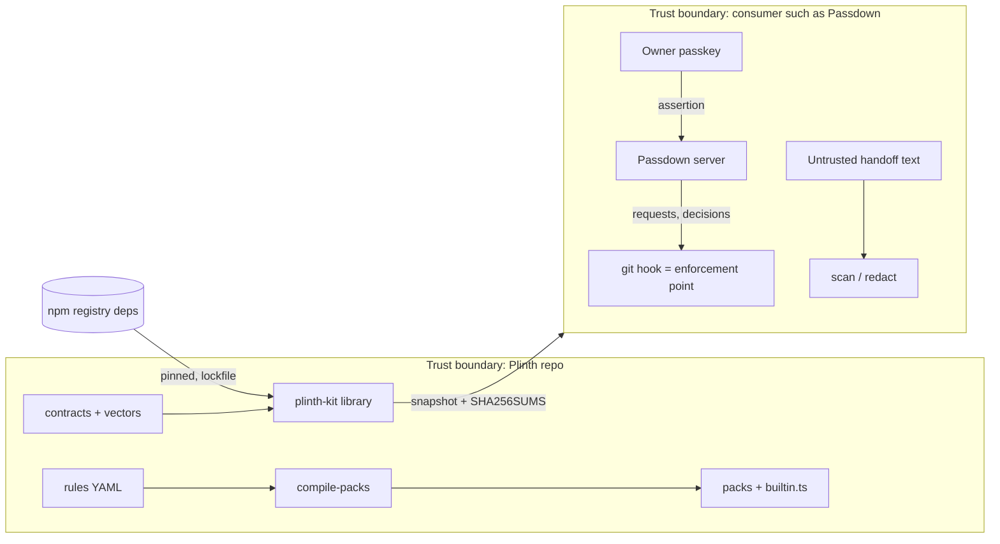

# Plinth 0.1: threat model

**Status:** Stage 3, v1.0 (2026-10-31). Refreshed in `docs/07-security-review.md` at release (T-MR-05).
Plinth is a library: it holds no data and runs no service. Its threats are **wrong answers** (a verifier says "valid" when it should not), **leaks** (a secret escapes through findings, errors or logs) and **supply chain** (the kit or its release is tampered with). Every product that uses it inherits these mitigations and must copy the "honest limits" into its own threat model.

## 1. Assets, actors, trust boundaries
| Asset | Sensitivity | Where |
|---|---|---|
| Correctness of verifiers (envelope, chain, approval, registry) | Critical: products' security rests on it | `packages/ts/src` |
| Contracts and golden vectors | Critical: they define "correct" | `contracts/` |
| Rule packs (what gets redacted) | High | `rules/`, `packs/`, `builtin.ts` |
| Consumers' secrets and personal data passing through `scan`/`redact` | Critical, in memory only | consumer runtime |
| Consumers' keys (service Ed25519 keys, installation secret) | Critical, passed in by the consumer | consumer secret store |
| Release snapshot integrity | Critical | `snapshot/`, consumers' `vendor/plinth/` |
| TEST-ONLY keys | Public by design | `contracts/test-vectors/keys/` |

**Actors:** owner (trusted); executor agent (honest but weak: may invent APIs, weaken tests); **compromised agent** (prompt-injected, tries to make broken code pass or push to `main`); **malicious insider at a consumer** (DB access, wants to rewrite logs or approve their own change); **compromised consumer server** (wants to mint approvals); external attacker (hostile input text, hostile packages, network observer of the public repo); auditor (reads outputs).

## 2. Data flows
1. Untrusted JSON text → `parseJson` → objects → `canonicalize`/`digest`.
2. Payload + key (consumer) → `signEd25519` → envelope → any verifier with pinned trusted keys.
3. Passkey assertion (browser) → `signatureFromAssertion` → decision envelope → `verifyAndConsume` at the enforcement point with the pinned registry.
4. Audit drafts → `appendEvent` → consumer storage → export lines + checkpoints → `verifyChain`.
5. Rule YAML → compiler → packs → `loadPack` (digest check) → `scan`/`redact` on untrusted text → findings (no raw values).
6. Tag → snapshot → `vendor` → consumer `vendor/plinth/` → `verify-snapshot.sh` + conformance in consumer CI.

## 3. STRIDE table
| ID | Flow / component | Threat (STRIDE) | L | I | Mitigation | Verifying test (file::name) | Task | Residual |
|---|---|---|---|---|---|---|---|---|
| TM-01 | 1 parseJson/canonicalize | T: two parsers read the same bytes differently (duplicates, floats, `-0`, surrogates) so one hash covers two meanings | M | H | Strict I-JSON parser; integers only; no null; UTF-16 key order; depth 64 | `test/core/k0-vectors.test.ts::k0 vectors parseAndCanonicalize` | T-M1-03, T-M1-04 | Low |
| TM-02 | 2 envelope | S/T: signature for one purpose replayed as another type | M | H | PAE covers `type`; per-verifier type allowlist | `test/core/k0-vectors.test.ts::k0-env-err-wrong-type` and `::k0-env-err-type-not-allowed` | T-M1-07, T-M1-08 | Low |
| TM-03 | 2, 3 envelope | S: algorithm confusion (unknown alg "tried", Ed25519 software key approving, key/alg mismatch) | M | H | Closed alg list; per-type algs; key type must match alg; decisions allow only webauthn-ES256/ES256 | `k0-vectors.test.ts::k0-env-err-unknown-alg`, `::k0-env-err-key-alg-mismatch`; `test/approval/k2-vectors.test.ts::k2-approval-ed25519-not-allowed` | T-M1-08, T-M3-05 | Low |
| TM-04 | 2 ECDSA | T: malformed or malleable DER accepted; signatures used as IDs | M | M | Strict DER parser; P1363 only in envelopes; IDs are payload digests; high-S accepted (malleability is harmless because sigs are never IDs) | `k0-vectors.test.ts::k0-der-err-non-minimal`, `::k0-env-err-es256-der-in-envelope` | T-M1-06 | Low |
| TM-05 | 2 envelope | S: envelope "brings its own key" | M | H | Only `trustedKeys` from a pinned source; unknown kid → invalid | `k0-vectors.test.ts::k0-env-err-unknown-kid` | T-M1-08 | Low |
| TM-06 | 3 WebAuthn | S: assertion from a phishing origin, other RP, without fingerprint/PIN, or for other bytes | M | H | Check type, challenge, origin, crossOrigin, rpIdHash, UP, UV, DER signature, in that order | `k2-vectors.test.ts::k2-approval-wrong-origin`, `-wrong-rpid`, `-uv-off`, `-up-off`, `-wrong-challenge`, `-wrong-clientdata-type`, `-cross-origin` | T-M1-09 | Low |
| TM-07 | 3 approval | T/E: approval for commit A used to push commit B (subject not recomputed) | H | H | `actualSubjectDigest` is a required argument with no default; compared before any signature work | `k2-vectors.test.ts::k2-approval-subject-mismatch` | T-M3-04 | Low (product must pass the real SHA) |
| TM-08 | 3 approval | R/E: same approval reused at the same verifier | H | H | Single-use id; `verifyAndConsume` uses atomic `store.add` | `test/approval/store.test.ts::concurrent verifyAndConsume admits exactly one` and `k2-approval-replayed` | T-M3-06 | Low |
| TM-09 | 3 approval | E: same approval replayed at a *different* verifier with its own store | L | M | Subject binding (same commit only) and short TTL (≤ registry max, Passdown 600 s) | `k2-vectors.test.ts::k2-approval-ttl-too-long` | T-M3-04 | **Accepted**: stated in K2 spec §4 |
| TM-10 | 3 registry | E: compromised server adds its own approver key | M | H | Registry change must be signed by a key of the previous version; genesis pinned by digest | `k2-vectors.test.ts::k2-registry-update-unauthorised`, `::k2-registry-genesis-mismatch` | T-M3-03 | Low |
| TM-11 | 3 registry | T: rollback to an old registry that still lists a removed key | M | H | `highestSeenVersion` anti-rollback | `k2-vectors.test.ts::k2-registry-rollback` | T-M3-03 | Low (verifier must persist the number) |
| TM-12 | 3 approval | E: requester approves own request; owner approves the wrong request (fatigue); request downgrades policy or spoofs `human_id` | M | H | Enforcement-side `actionPolicies` + `requesterHumanId` (`distinct_from_requester`); matching code on both screens; any deny wins | `k2-vectors.test.ts::k2-approval-self-approval`, `::k2-approval-policy-downgrade`, `::k2-approval-distinct-downgrade`, `::k2-matching-code`, `::k2-approval-denied` | T-M3-02, T-M3-05, T-M3-10 | Low |
| TM-13 | 3 approval | S: synced passkey (cloud account takeover) approves in a regulated realm | M | H | Realm flag `allow_synced_passkeys`; BE flag from the assertion | `k2-vectors.test.ts::k2-approval-synced-passkey-refused` | T-M3-05 | Accepted for solo realms (owner decision 2026-10-31) |
| TM-14 | 3 approval | T: expired or future-dated approvals; very long TTLs | M | M | TTL ≤ `max_ttl_seconds`; ±300 s skew; windows without skew | `k2-approval-expired`, `-not-yet-valid`, `-window-not-open` | T-M3-04 | Low |
| TM-15 | 4 audit | T: event edited, deleted, reordered or truncated | H | H | Hash chain + seq continuity + checkpoints; first failing seq reported | `test/audit/k1-vectors.test.ts::k1-chain-tamper-*` (8 vectors) | T-M2-05 | Low |
| TM-16 | 4 audit | T: insider rewrites the whole chain | M | H | Checkpoints signed and anchored outside the DB; verifier reports "intact, not anchored" honestly | `k1-vectors.test.ts::k1-chain-tamper-full-rewrite`, `::k1-chain-valid-unanchored-tail` | T-M2-05 | Medium until the product anchors checkpoints |
| TM-17 | 4 audit | R: pruning used to hide events | M | M | Prune only after a checkpoint; `pk.audit.pruned` event required | `k1-vectors.test.ts::k1-chain-pruned-without-anchor`, `::k1-chain-pruned-unrecorded` | T-M2-05 | Low |
| TM-18 | 4 audit | I: personal data in an immutable log (DPDP erasure) | M | M | Rule "IDs and digests only"; `lintPersonalData` for product tests | `test/audit/lint.test.ts::k1-lint-aadhaar-in-event` | T-M5-07 | Medium (lint is a test tool, not enforcement) |
| TM-19 | 5 detect | I: raw secret in findings, error details or CLI output | M | H | Findings carry offsets, masked preview, keyed fingerprint only; `detail` never holds input; CLI prints masked preview | `test/detect/redact.test.ts::findings never echo the secret`; `test/repo-tools/detect-file.test.ts::output never contains the secret` | T-M5-05, T-M5-08 | Low |
| TM-20 | 5 detect | I: secret brute-forced from the placeholder fingerprint | L | M | HMAC with a ≥ 32-byte installation secret; 4 hex shown | `k5-vectors.test.ts::k5-redact-err-no-secret` | T-M5-05 | Low |
| TM-21 | 5 detect | I: Aadhaar stored or linkable | M | H | PII never fingerprinted; Aadhaar `store: never`, preview `…` | `k5-vectors.test.ts::k5-redact-aadhaar-no-fingerprint` | T-M5-05 | Low |
| TM-22 | 5 detect | I: secret not detected (false negative), esp. unverified Indian formats | M | H | 70 rule tests; experimental rules still applied; owner gate with real test-mode keys | `test/detect/pack-tests.test.ts::every pack test passes`; gate G-K5 record in LOG | T-M5-01, T-M5-09 | **Medium**: detection is defence in depth |
| TM-23 | 5 detect | D: ReDoS with hostile text | M | M | Portable dialect, star-height lint, 1,000,000-unit cap, perf test | `k4-vectors.test.ts::k4-regex-err-nested-quantifier`; `test/perf.test.ts::no rule exceeds 100 ms on adversarial input` | T-M4-04, T-M5-10 | Low |
| TM-24 | 5 detect | T: hidden characters or injection phrases in agent handoffs | H | M | Hidden-char classes and phrase heuristics reported to the product | `k5-vectors.test.ts::k5-scan-hidden-and-phrases` | T-M5-04 | **Medium**: heuristics; product quarantines |
| TM-25 | 5 packs | T: weakened or swapped rule pack | L | H | Manifest digests checked by `loadPack`; `packs:check` in CI; `SHA256SUMS` | `test/rulepack/load.test.ts::tampered rules file is refused` | T-M4-07, T-M4-08 | Low |
| TM-26 | 5 compiler | T: YAML 1.1/1.2 differences change a rule's meaning | L | M | Safe YAML subset; products read only compiled JSON | `k4-vectors.test.ts::k4-yaml-*` | T-M4-03 | Low |
| TM-27 | 6 release | T: vendored copy edited or replaced in a consumer | M | H | `SHA256SUMS` + `plinth.pin` + npm lockfile integrity + conformance in consumer CI | `test/repo-tools/verify-snapshot.test.ts::tampered byte fails` and `::pin mismatch fails` | T-MR-02 | Low |
| TM-28 | supply chain | T/E: malicious dependency version | L | H | 3 runtime deps, exact pins, lockfile, 14-day cooldown, osv-scanner, monthly Dependabot, manual review of each bump | `test/deps.test.ts::runtime dependencies are exactly the pinned three` | T-M0-04, T-M0-05 | Low |
| TM-29 | 2, 3 | S: TEST-ONLY key ends up trusted in production | M | H | `TEST_KIDS`, `isTestKid`; consumers must fail CI | `test/core/keys.test.ts::isTestKid recognises all five` | T-M1-05 | Low (consumer must call it) |
| TM-30 | repo | I: real keys in tests; push protection blocks public pushes | M | M | Synthetic values only, split into parts; gitleaks over full history | `security-scan` workflow run (gitleaks clean) | T-M0-05, T-MR-08 | Low |
| TM-31 | 1 parseJson | T/E: `__proto__` key pollutes prototypes | L | H | Own data properties via `Object.defineProperty` | `test/core/json.test.ts::__proto__ becomes an own property` | T-M1-03 | Low |
| TM-32 | repo | T: a compromised or weak agent edits contracts/vectors so broken code passes | M | H | `index.json` hashes test; contracts change needs ADR + owner; strong-model reviews R1, R2 | `test/contracts.test.ts::vector files match index.json` | T-M0-04 | Low |
| TM-33 | 3 enforcement | E: attacker controls the enforcement point (local admin) and skips verification | L | H | Out of scope for the kit; stated in K2 §6 | none (documented limit) | — | **Accepted** |
| TM-34 | 1 parseJson | D: deeply nested JSON exhausts the stack | L | M | Depth limit 64 | `k0-vectors.test.ts::k0-jcs-err-depth` | T-M1-03 | Low |
| TM-35 | 2-5 | D/I: verifier throws on malformed input and the caller treats the exception as "pass" | M | H | "Never throws" verifiers return `valid:false` | `test/core/envelope.test.ts::verifyEnvelope never throws`, `test/audit/verify.test.ts::verifyChain never throws`, `test/approval/verify.test.ts::verifyApproval never throws` | T-M1-08, T-M2-05, T-M3-05 | Low |
| TM-36 | 3 registry | E: single rogue approver in a multi-person realm adds a sockpuppet key or weakens registry policy | M | H | `update_threshold` requires M distinct approver `id`s from version n to sign version n+1 | `k2-vectors.test.ts::k2-registry-update-threshold-insufficient`, `registry.test.ts::requires distinct approver IDs` | T-M3-11 | Low (multi-person realms must set `update_threshold`) |

## 4. Abuse and misuse cases, "two hands" gates
- **Self-approval by a prompt-injected agent:** agents hold no approver key; decisions require webauthn-ES256/ES256 from registry keys; registry changes need an existing approver. Ed25519 (the only key type a server could hold) can never sign a decision (TM-03).
- **Fake owner quotes in data:** `pk.untrusted.phrase.claimed_approval` flags "the owner approved"; only signed decisions count.
- **Dual-use:** the secret patterns are public knowledge (gitleaks-derived); the kit performs no liveness checks and no network calls.
- **"Two hands" in the kit's own process:** contract changes (ADR + owner OK), merge to `main` (owner phrase + click), tag creation (owner), going public (owner).

## 5. Data inventory (DPDP)
| Data | Why | Where | Retention | Deletion | DPDP basis |
|---|---|---|---|---|---|
| None stored by Plinth | — | — | — | — | Not a data fiduciary for any user data |
| Text passed to `scan`/`redact` (may contain personal data) | Find and remove secrets/PII | Consumer process memory only, for the call | Call duration | Garbage-collected | Consumer's basis (Passdown: legitimate use for its own service; minimisation) |
| Synthetic test values (Aadhaar-like `2949 1013 6515`, PAN `ABCPE1234F`, names "Priya", "Ramesh", "Ravi") | Tests | Repo | Permanent | n/a | Not personal data (synthetic) |
| Owner's real Razorpay/Cashfree test-mode keys (gate G-K5) | Verify formats | A file **outside** the repo on the owner's PC; only masked output pasted | Deleted by the owner after the gate | Owner deletes file and revokes keys | Owner's own data |

## 6. Supply chain
- Exact pins in both `package.json` files; `package-lock.json` committed; `npm ci` everywhere.
- 14-day cooldown on new versions (ADR-0008); Dependabot monthly into `development`; each bump reviewed with `npm view <pkg> time` and changelog.
- `security-scan.yml` (gitleaks v8.30.1 full history, osv-scanner v2.7.0) on PRs into `main`.
- Third-party actions: none besides `actions/*` (major tags).
- Release integrity: owner-created tag on `main`; snapshot built from a clean checkout of the tag; `SHA256SUMS` digest recorded in `docs/releases.md` and in each consumer's `plinth.pin`. Signing the snapshot with an Ed25519 maintainer key is **not** in 0.1 (no key ceremony yet); it is planned with K3 (0.2).
- After going public: CodeQL default setup, secret scanning with push protection, ruleset on `main`.

## 7. Security test checklist for `docs/07-security-review.md` (T-MR-05)
1. All 150 runtime + 27 tool vectors and 70 pack tests pass at the release commit (paste result lines with SHA).
2. Mutation checks done and logged for each protection in `docs/testing.md` §6.
3. `test/portability.test.ts` and `test/deps.test.ts` green; `npm ls --omit=dev --all` shows only the 3 runtime deps.
4. `security-scan` green on the release PR (gitleaks: 0 leaks; osv: no unaccepted high/critical).
5. Spike T-M3-08 result recorded (real authenticator assertion verified or the pre-decided fix applied).
6. Gate G-K5 result recorded; India rules' `verified` fields updated per its outcome.
7. Independent review by a different model than the builder (prompt in `docs/testing.md` §8), given this threat model and the code, not the builder's conclusions.
8. "Not checked" section filled in honestly (for example: no fuzzing campaign, no third-party audit, C#/Kotlin not built).
9. Owner sign-off quoted with date.
